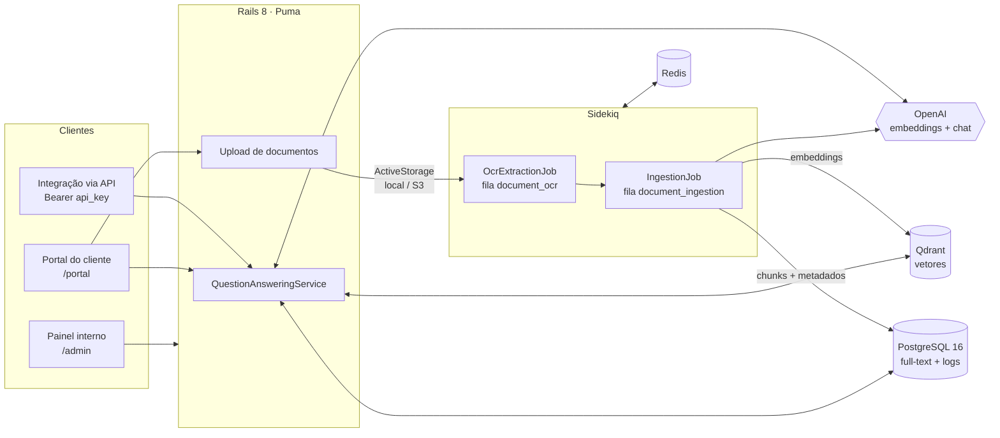
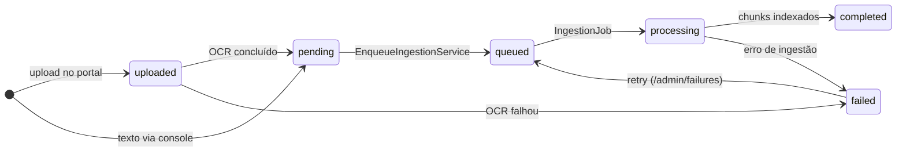
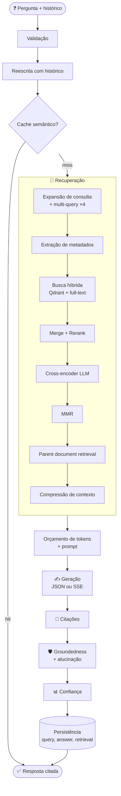

<div align="center">

# 📑 JLP RAG

### Perguntas em linguagem natural sobre averbação de apólices, com respostas citadas e verificáveis

[](https://www.ruby-lang.org/)
[](https://rubyonrails.org/)
[](https://www.postgresql.org/)
[](https://qdrant.tech/)
[](https://sidekiq.org/)
[](https://platform.openai.com/)
[](#-testes-e-qualidade)
[](#-testes-e-qualidade)

[Visão geral](#-visão-geral) •
[Arquitetura](#-arquitetura) •
[Pipeline](#-pipeline-de-rag) •
[Começando](#-começando) •
[API](#-api) •
[Backoffices](#-backoffices) •
[Testes](#-testes-e-qualidade)

</div>

---

## ✨ Visão geral

O **JLP RAG** é uma aplicação Rails 8 que recebe documentos de averbação
de apólices (PDFs, imagens ou texto), indexa o conteúdo e responde
perguntas sobre ele usando **RAG** (*Retrieval-Augmented Generation*).

> **Pergunta:** Quais documentos fiscais o sistema suporta?
>
> **Resposta:** O sistema suporta os seguintes documentos fiscais eletrônicos: MDFe, CTe e NFe **[FONTE 1]**.
>
> `grounded: true` · `confidence: medium (0.63)` · `1 citação`

> **Pergunta:** Qual a capital da França?
>
> **Resposta:** Não encontrei informações suficientes nas fontes fornecidas para responder a esta pergunta.
>
> `refused` · `0 citações`: fora do escopo dos documentos, ele não inventa resposta

### Destaques

| | |
| --- | --- |
| 🔎 **Busca híbrida** | Vetorial (Qdrant) + full-text (PostgreSQL), com multi-query e expansão de consulta |
| 🎯 **Reranking em camadas** | Rerank, cross-encoder via LLM e MMR para relevância e diversidade |
| 📌 **Citações** | Cada afirmação aponta para o trecho exato que a sustenta (`[FONTE n]`) |
| 🛡️ **Anti-alucinação** | Checagem de groundedness, recusa quando não há evidência, detecção de prompt injection na ingestão |
| 📊 **Score de confiança** | `low` / `medium` / `high`, média ponderada de retrieval, cross-encoder, citações, groundedness e fidelidade |
| ⚡ **Streaming** | Respostas token a token via Server-Sent Events |
| 💬 **Conversa** | Histórico multi-turno com reescrita de perguntas de acompanhamento |
| 🖼️ **OCR** | PDFs com camada de texto (pdf-reader) e imagens (Tesseract), armazenados localmente ou no S3 |
| 🏢 **Multi-tenant** | Dados isolados por conta, API key por conta e rate limit por conta |
| 🧪 **Avaliação** | Rodadas de avaliação com precisão, recall, fidelidade e cobertura de citações |
| 🖥️ **Backoffices** | Portal self-service para clientes e painel de operação interno (Tabler) |

---

## 🏗️ Arquitetura



| Componente | Papel |
| --- | --- |
| **Rails 8 / Puma** | API JSON (`/api/v1`) e backoffices HTML (`/portal`, `/admin`) |
| **PostgreSQL 16** | Contas, usuários, documentos, chunks, full-text search, logs de consultas e respostas, avaliações |
| **Qdrant** | Busca vetorial nas coleções `document_chunks` e `semantic_cache_entries` |
| **Redis + Sidekiq** | Jobs assíncronos de OCR e ingestão |
| **OpenAI** | Embeddings `text-embedding-3-small` (1536 dimensões) e chat `gpt-4.1-mini` (padrão) |
| **ActiveStorage** | Arquivos enviados pelo portal, em disco local ou no S3 |
| **pdf-reader / Tesseract** | Extração de texto de PDFs digitais e OCR de imagens |

### Ciclo de vida de um documento



A ingestão divide o texto em chunks de ~500 tokens, com 75 tokens de
sobreposição, gera os embeddings em lote e grava em Postgres e Qdrant.

---

## 🧠 Pipeline de RAG

Cada pergunta percorre uma sequência de *steps* plugáveis
(`Documents::QuestionAnsweringService` → `Documents::RetrievalPipelineService`).
Cada step pode ser ligado ou desligado.



<details>
<summary><b>Steps e padrões</b></summary>

| Etapa | Padrão | O que faz |
| --- | :---: | --- |
| Query expansion | ✅ | Gera termos relacionados à pergunta |
| Multi-query | ✅ | Reformula a pergunta em 4 variações e junta os resultados |
| Metadata extraction | ✅ | Extrai filtros da pergunta, como o ano de vigência |
| Hybrid search | ✅ | Combina similaridade vetorial com ranking full-text |
| Cross-encoder | ✅ | Reordena candidatos com o LLM julgando a relevância de cada um |
| MMR | ✅ | Equilibra relevância e diversidade (λ = 0.70) |
| Parent document retrieval | ✅ | Expande o chunk para o contexto vizinho |
| Context compression | ✅ | Remove trechos redundantes antes do prompt |
| Citations | ✅ | Liga cada `[FONTE n]` ao chunk de origem |
| Groundedness check | ✅ | Verifica se a resposta é sustentada pelas fontes |
| Confidence score | ✅ | Calcula score e nível de confiança |
| Hallucination check | ⬜ | Verificação extra por LLM |
| Semantic cache | ⬜ | Reaproveita respostas de perguntas muito parecidas |
| Token budget / adaptive retrieval / query router | ⬜ | Ajustam o pipeline dinamicamente |

</details>

---

## 🚀 Começando

### Pré-requisitos

- **Ruby 3.3.6** (veja `.ruby-version`)
- **Docker** + Docker Compose
- **Chave da OpenAI**
- `tesseract-ocr` na máquina do Sidekiq, para OCR de imagens

### 1. Subir a infraestrutura

```bash
docker compose up -d
```

| Serviço | Container | Porta |
| --- | --- | --- |
| 🐘 PostgreSQL | `ruby-rag-database` | `5432` |
| 🟥 Redis | `ruby-rag-redis` | `6380` |
| 🧭 Qdrant | `ruby-rag-qdrant` | `6333` (REST + [dashboard](http://localhost:6333/dashboard)) · `6334` (gRPC) |

> [!TIP]
> Se alguma porta já estiver em uso por outro projeto, ajuste o
> mapeamento no `compose.yml` e as variáveis `DATABASE_PORT`, `REDIS_URL`
> e `QDRANT_URL`.

### 2. Configurar o `.env`

```dotenv
DATABASE_HOST=localhost
DATABASE_PORT=5432
DATABASE_NAME=ruby_rag_development
DATABASE_TEST_NAME=ruby_rag_test
DATABASE_USERNAME=postgres
DATABASE_PASSWORD=postgres
REDIS_URL=redis://localhost:6380/0
QDRANT_URL=http://localhost:6333

OPENAI_API_KEY=sk-...
OPENAI_BASE_URL=https://api.openai.com/v1
OPENAI_EMBEDDING_ENDPOINT=/embeddings
OPENAI_CHAT_COMPLETION_ENDPOINT=/chat/completions
```

<details>
<summary><b>📋 Todas as variáveis de ambiente</b></summary>

| Variável | Padrão | Descrição |
| --- | --- | --- |
| `DATABASE_HOST` / `DATABASE_PORT` | — | Conexão com o Postgres |
| `DATABASE_NAME` / `DATABASE_TEST_NAME` | — | Bancos de desenvolvimento e de teste |
| `DATABASE_USERNAME` / `DATABASE_PASSWORD` | — | Credenciais do Postgres |
| `REDIS_URL` | — | Redis do Sidekiq (`redis://localhost:6380/0` com o compose) |
| `QDRANT_URL` | `http://localhost:6333` | URL do Qdrant |
| `QDRANT_API_KEY` | — | Só se o Qdrant exigir autenticação |
| `OPENAI_API_KEY` | — | **Obrigatória** |
| `OPENAI_BASE_URL` | `https://api.openai.com` | Base da API (aceita gateways compatíveis com OpenAI) |
| `OPENAI_EMBEDDING_ENDPOINT` | `https://api.openai.com/v1/embeddings` | Caminho ou URL de embeddings |
| `OPENAI_CHAT_COMPLETION_ENDPOINT` | `https://api.openai.com/v1/chat/completions` | Caminho ou URL de chat |
| `OPENAI_EMBEDDING_MODEL` | `text-embedding-3-small` | Precisa gerar vetores de 1536 dimensões |
| `OPENAI_EMBEDDING_BATCH_SIZE` | `100` | Chunks por requisição de embedding |
| `OPENAI_CHAT_MODEL` | `gpt-4.1-mini` | Modelo de geração |
| `OPENAI_CHAT_TEMPERATURE` | `0.2` | Temperatura da geração |
| `OPENAI_CHAT_MAX_COMPLETION_TOKENS` | `800` | Limite de tokens da resposta |
| `OPENAI_HTTP_OPEN_TIMEOUT` / `OPENAI_HTTP_READ_TIMEOUT` | `10` / `60` | Timeouts em segundos |
| `DOCUMENT_UPLOAD_ENABLED` | `false` | Libera o upload de arquivos no portal |
| `ACTIVE_STORAGE_SERVICE` | `local` | Use `amazon` para S3 (credenciais em `rails credentials`: `aws.access_key_id` e `aws.secret_access_key`) |
| `AWS_REGION` / `AWS_S3_BUCKET` | `us-east-1` / `jlp-documents-<env>` | Bucket S3 |

</details>

### 3. Instalar, migrar e preparar o Qdrant

```bash
bundle install
bin/rails db:create db:migrate
bin/rails qdrant:setup
```

> [!IMPORTANT]
> A migration `AddAccountIdToMultipleTables` cria duas contas seed (uma
> padrão e uma operadora, **"Operador JLP"**) e imprime as `api_key` no
> log. **Copie as chaves nessa hora**, porque elas não ficam salvas em outro
> lugar. Se perder, crie uma conta nova pelo console:
>
> ```ruby
> Account.create!(name: "Minha conta", operator: true).api_key
> ```

### 4. Rodar

```bash
bundle exec sidekiq -C config/sidekiq.yml   # worker de OCR e ingestão (obrigatório)
bin/rails server                            # http://localhost:3000
```

`/` abre o **portal do cliente** e `/admin` abre o **painel interno**.

### 5. Alimentar a base de conhecimento

**Pelo portal:** defina `DOCUMENT_UPLOAD_ENABLED=true` e envie um PDF
digital ou uma imagem (png, jpg, tiff) em *Documentos → Novo*.

**Pelo console**, com o texto já pronto:

```ruby
account = Account.find_by!(name: "Minha conta")
doc = Document.create!(account:, title: "Manual", content: File.read("manual_averbgo.md"))
Documents::EnqueueIngestionService.call(document: doc)
```

> [!NOTE]
> PDFs escaneados sem camada de texto ainda não são suportados. O OCR
> retorna `UnsupportedFileError` e o documento vai para `failed`.

---

## 🔌 API

Todas as rotas de `/api/v1` exigem o cabeçalho
`Authorization: Bearer <api_key>` de uma conta ativa.

| Regra | |
| --- | --- |
| Sem token ou token inválido | `401` |
| Rotas `/api/v1/admin/*` com conta não operadora | `403` |
| Rate limit em `/questions` | **20 req/min por conta**, depois `429` |
| Tamanho do histórico | até 20 turnos de 4.000 caracteres |

### 💬 Perguntar

```bash
curl -X POST http://localhost:3000/api/v1/questions \
  -H "Authorization: Bearer $API_KEY" \
  -H "Content-Type: application/json" \
  -d '{"question": "Quais documentos fiscais o sistema suporta?"}'
```

<details open>
<summary><b>Resposta</b></summary>

```json
{
  "question": "Quais documentos fiscais o sistema suporta?",
  "effective_question": "Quais documentos fiscais o sistema suporta?",
  "answer": "O sistema suporta os seguintes documentos fiscais eletrônicos: MDFe, CTe e NFe [FONTE 1].",
  "sources": [
    {
      "chunk_id": 81,
      "document_id": 40,
      "content": "# Manual Técnico do Sistema JLP ...",
      "cited": true,
      "hybrid_score": 0.435,
      "rerank_score": 0.647,
      "cross_encoder_score": 1,
      "mmr_score": 0.7
    }
  ],
  "citations": [{ "source_number": 1, "chunk_id": 81, "document_id": 40 }],
  "citation_coverage": 0.33,
  "grounded": true,
  "refused": false,
  "confidence_score": 0.63,
  "confidence_level": "medium",
  "cache_hit": false,
  "model": "gpt-4.1-mini-2025-04-14",
  "total_tokens": 1328,
  "duration_ms": 7435,
  "rag_query_id": 28,
  "rag_answer_id": 28
}
```

</details>

**Com histórico de conversa.** Perguntas de acompanhamento são reescritas
antes da busca, e o campo `effective_question` mostra a versão usada:

```json
{
  "question": "E quem pode iniciar isso?",
  "conversation_history": [
    { "role": "user", "content": "Como funciona o reprocessamento?" },
    { "role": "assistant", "content": "Documentos com falha podem ser reprocessados..." }
  ]
}
```

### ⚡ Streaming (SSE)

```bash
curl -N -X POST http://localhost:3000/api/v1/questions/stream \
  -H "Authorization: Bearer $API_KEY" \
  -H "Content-Type: application/json" \
  -d '{"question": "O que é averbação?"}'
```

```text
event: delta
data: {"content":"A"}

event: delta
data: {"content":" aver"}

event: delta
data: {"content":"bação"}
...
event: done
data: { ...resultado completo, igual ao endpoint síncrono... }
```

| Evento | Conteúdo |
| --- | --- |
| `delta` | Um trecho do texto: `{"content": "..."}` |
| `done` | Resultado completo, com fontes, citações e confiança |
| `error` | Falha depois que o stream já começou |

### 👍 Feedback

```bash
curl -X POST http://localhost:3000/api/v1/answers/$RAG_ANSWER_ID/feedbacks \
  -H "Authorization: Bearer $API_KEY" \
  -H "Content-Type: application/json" \
  -d '{"rating": "positive", "reason": "Resposta correta"}'   # rating: positive | negative
```

### 📚 Referência de endpoints

| Método | Rota | Descrição | Acesso |
| --- | --- | --- | :---: |
| `POST` | `/api/v1/questions` | Pergunta com resposta completa | 🔑 |
| `POST` | `/api/v1/questions/stream` | Pergunta com streaming SSE | 🔑 |
| `POST` | `/api/v1/answers/:answer_id/feedbacks` | Avaliar uma resposta | 🔑 |
| `GET` | `/api/v1/admin/dashboard` | Métricas gerais | 🛠️ |
| `GET` | `/api/v1/admin/documents[/:id]` | Documentos | 🛠️ |
| `GET` | `/api/v1/admin/queries[/:id]` | Consultas registradas | 🛠️ |
| `GET` `POST` | `/api/v1/admin/evaluations[/:id]` | Rodadas de avaliação do RAG | 🛠️ |
| `GET` | `/api/v1/admin/failures` | Ingestões com falha | 🛠️ |
| `POST` | `/api/v1/admin/failures/retry_all` | Reenfileirar todas as falhas | 🛠️ |
| `POST` | `/api/v1/admin/failures/reconcile_stale_processing` | Marcar documentos presos como falha | 🛠️ |
| `GET` | `/up` | Health check | 🌐 |

🔑 qualquer conta ativa · 🛠️ conta operadora · 🌐 público

---

## 🖥️ Backoffices

<table>
<tr>
<td width="50%" valign="top">

### 👥 Portal do cliente
**`/portal`**: login por e-mail e senha

- **Cadastro self-service**: cria a conta e o primeiro usuário, que vira o *owner*
- Dashboard da conta
- Lista e upload de documentos, com status do OCR e da ingestão
- **Gestão do time** (só para o *owner*): convidar e desativar colegas
- Troca de senha

</td>
<td width="50%" valign="top">

### 🛠️ Painel interno
**`/admin`**: login com a `api_key` de uma conta operadora

- Dashboard global de uso e qualidade
- Documentos e consultas de todas as contas
- Falhas de ingestão, com *retry* e reconciliação
- Avaliações do RAG
- Contas, usuários e permissões de operador
- Log de auditoria das ações administrativas

</td>
</tr>
</table>

---

## 🧪 Avaliação do RAG

As rodadas de avaliação (`/admin/evaluations`) executam um conjunto de
casos de teste (`RagEvalCase`) contra o pipeline real e medem:

| Métrica | Pergunta que responde |
| --- | --- |
| `retrieval_precision` | Os chunks recuperados são relevantes? |
| `retrieval_recall` | Os chunks esperados foram recuperados? |
| `chunk_relevance` | O contexto enviado ao LLM é bom? |
| `answer_faithfulness` | A resposta é fiel às fontes? |
| `citation_coverage` | As afirmações estão citadas? |
| `no_evidence_correct` | Recusou quando deveria recusar? |

---

## 🧰 Tarefas rake

```bash
bin/rails qdrant:setup                                       # cria as coleções no Qdrant (idempotente)
bin/rails documents:reconcile_stale_processing               # marca como failed os documentos presos em processing
QUESTION="o que é averbação?" LIMIT=3 bin/rails rag:search   # busca semântica direto pelo terminal
```

---

## ✅ Testes e qualidade

```bash
RAILS_ENV=test bin/rails db:create db:test:prepare
bundle exec rspec        # 651 exemplos
bin/rubocop              # estilo (rubocop-rails-omakase)
bin/brakeman             # análise de segurança
```

A suíte **não chama a OpenAI nem o Qdrant**: usa stubs e
`Ai::InMemoryVectorStore`. Só o Postgres e o Redis precisam estar
rodando.

<details>
<summary><b>🗄️ Sobre o <code>db/structure.sql</code></b></summary>

O schema é versionado em `db/structure.sql`, e não em `schema.rb`,
porque há triggers e funções em SQL puro que o `schema.rb` não captura.
Depois de qualquer migration, regenere o arquivo com o `pg_dump` do
container, que costuma ser mais novo que o local:

```bash
docker exec ruby-rag-database pg_dump --schema-only --no-privileges --no-owner \
  -U postgres ruby_rag_development > db/structure.sql
```

O `pg_dump` 16.10+ adiciona as linhas `\restrict` e `\unrestrict`. Elas
exigem um `psql` local recente (14.19+, 15.14+ ou 16.10+) para o
`db:test:prepare`. Se o seu for mais antigo, atualize o cliente ou remova
essas duas linhas.

</details>

---

## 📂 Estrutura do projeto

```text
app/
├── controllers/
│   ├── api/v1/            # API JSON (perguntas, streaming, feedback, admin)
│   ├── admin/             # painel interno (HTML)
│   └── portal/            # portal do cliente (HTML)
├── jobs/documents/        # OcrExtractionJob, IngestionJob
├── models/                # Account, User, Document, DocumentChunk, Rag*
└── services/
    ├── ai/                # clientes OpenAI, Qdrant, tokenizer, custos
    └── documents/
        ├── pipeline/steps/          # steps de retrieval e answering
        ├── cross_encoder/           # reranking via LLM
        ├── citation_engine/         # citações [FONTE n]
        ├── context_compression/    # compressão de contexto
        └── evaluation/              # métricas de avaliação
docs/manuals/              # manuais técnico e de negócio
spec/                      # RSpec (requests, services, models, jobs)
```

## 📖 Documentação adicional

- 📘 [Manual técnico](docs/manuals/manual_tecnico.md): arquitetura, modelo de dados e fluxos
- 📗 [Manual de negócio](docs/manuals/manual_negocio.md): visão de negócio e regras
- 📄 [`manual_averbgo.md`](manual_averbgo.md): documento de exemplo para alimentar o RAG

<div align="center">

---

Feito com ☕, Ruby e muitos embeddings.

</div>
